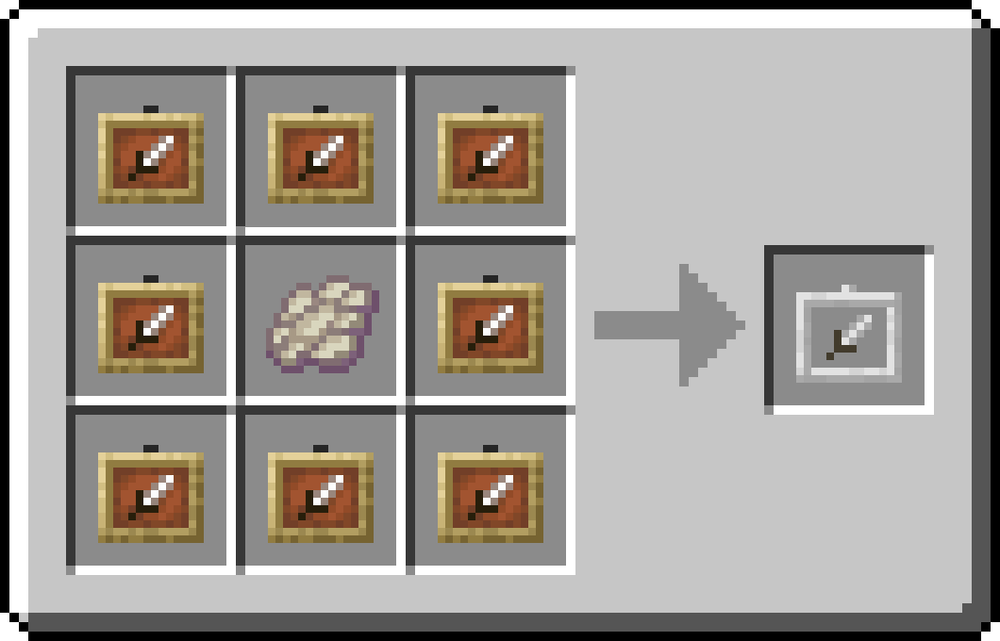

# Item Frames+

**Download: [Modrinth](https://modrinth.com/datapack/item-frames-plus/versions)**

Adds a crafting recipe for invisible item frames and the ability to lock them with a glass pane.

## Features
- Adds a crafting recipe for invisible item frames and glow item frames.
- Item frames are only invisible when there are items in them.
- Lock item frames by sneaking and right clicking with a glass pane.
- Support for custom textures with the `invisible_item_frame` and `invisible_glow_item_frame` strings
## Crafting


## Preview


## Wiki
#### Installing:
Insert the zip file into your datapacks folder.

#### Uninstalling:
Run the command `/function item_frames_plus:uninstall` and delete the zip file.

#### Contributing
Clone the repository and install the development tools in a Python virtual environment:

```sh
git clone https://github.com/DominoWWW/Item-Frames-Plus.git
cd Item-Frames-Plus
python -m venv .venv
source .venv/bin/activate
python -m pip install beet bolt
```

##### build
Build the datapack with:

```sh
beet build
```

##### Testing
**Individual Tests:** \
You need [carpet mod](https://modrinth.com/mod/carpet) installed to run the tests. 
```command
/test run <test>
```

**Run test server:** \
You need [carpet mod](https://modrinth.com/mod/carpet) and [GameTest Fabric](https://modrinth.com/mod/gametest-fabric) installed on a fabric server
Test server start command:
```sh
java -DbundlerMainClass="net.minecraft.gametest.Main" -jar server.jar --packs "<path/to/dir/with/the/datapack>"
```